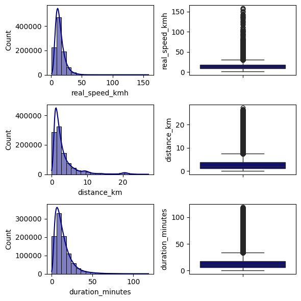
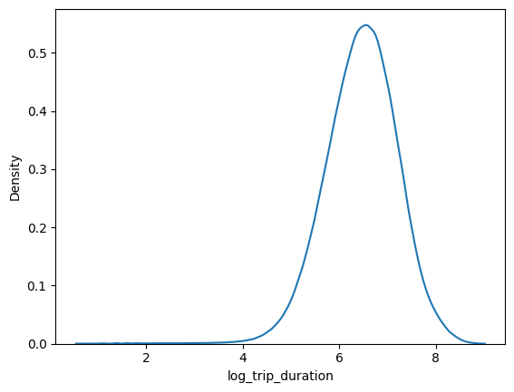
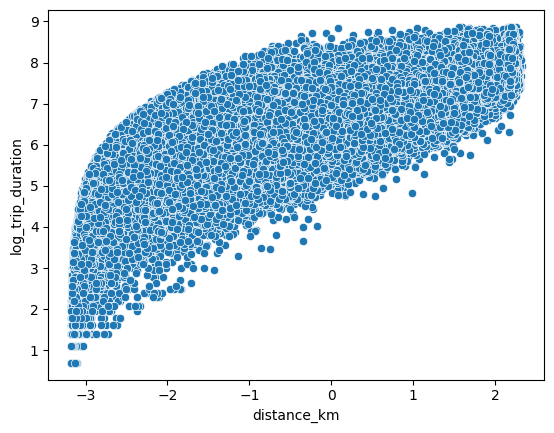
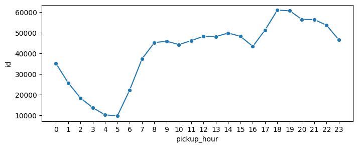

# NYC Taxi Trip Duration Prediction: Production Machine Learning Pipeline

[](https://www.python.org/downloads/release/python-31012/)
[](LICENSE)
[](https://github.com/psf/black)
[](tests/)

A modular, reproducible Machine Learning pipeline for predicting urban taxi trip durations in New York City using Yellow Taxi trip records from the New York City Taxi & Limousine Commission (TLC).

This project refactors exploratory data science research into an enterprise-grade ML architecture featuring schema validation, geospatial feature engineering, power transformations, harmonic temporal cyclical features, leak-free preprocessing, regression model benchmarking (Ridge, XGBoost, MLP), automated unit tests, and production CLI entry points for training, evaluation, and batch/single inference.

---

## 1. Project Overview & Problem Statement

### The Problem
Accurate travel time estimation is essential for dynamic rideshare pricing, fleet dispatching, vehicle routing, and passenger wait-time estimation. However, urban travel duration is influenced by non-linear spatial constraints (one-way avenues, river crossings), severe diurnal congestion spikes, weather anomalies, and high variance across short neighborhood hops versus long airport transits.

### The Objective
Given trip metadata initiated in NYC (pickup coordinates, dropoff coordinates, timestamp, passenger count, vendor), learn a mapping:
$$f(X) \to \log(1 + T)$$
that minimizes **Root Mean Squared Logarithmic Error (RMSLE)** on unseen holdout trips, where $T$ is the total elapsed trip duration in seconds.

### Why Log-Duration?
Raw taxi trip durations are strictly positive and heavily right-skewed, spanning from under a minute to multiple hours. Minimizing standard RMSE directly on seconds causes estimators to over-penalize long trips while underfitting short trips. Optimizing in log-space ($\log(1 + y)$):
1. Stabilizes error variance across different trip lengths.
2. Directly minimizes the standard competition metric:
   $$\text{RMSLE} = \sqrt{\frac{1}{N} \sum_{i=1}^N \left(\log(y_i + 1) - \log(\hat{y}_i + 1)\right)^2} \equiv \text{RMSE}_{\text{log}}$$
3. Transforms skewed distributions into near-Gaussian targets for stable model convergence.

---

## 2. Dataset Overview & Schema

The dataset is derived from the **New York City Taxi & Limousine Commission (TLC)** Yellow Taxi trip records, covering trips from **January 1, 2016 through June 30, 2016** (1,458,641 records total).

### Dataset Splits

| Split | Filename | Record Count | Approximate Size | Target Included | Role |
|---|---|---|---|---|---|
| **Train** | `train.csv` | 1,000,000 | ~114 MB | Yes (`trip_duration`) | Preprocessor fitting & model optimization |
| **Validation** | `val.csv` | 229,319 | ~26 MB | Yes (`trip_duration`) | Model selection & hyperparameter tuning |
| **Test** | `test.csv` | 229,322 | ~26 MB | Yes (`trip_duration`) | Final holdout benchmarking |

### Core Schema

| Column | Type | Description |
|---|---|---|
| `id` | `object` | Unique alphanumeric trip identifier |
| `vendor_id` | `int64` | Technology provider code ($1$ = CMT, $2$ = VeriFone) |
| `pickup_datetime` | `datetime` | Taximeter engagement timestamp |
| `passenger_count` | `int64` | Number of passengers ($0 \dots 7$) |
| `pickup_longitude`, `pickup_latitude` | `float64` | WGS84 GPS coordinates of pickup |
| `dropoff_longitude`, `dropoff_latitude` | `float64` | WGS84 GPS coordinates of dropoff |
| `store_and_fwd_flag` | `object` | Connection buffer flag (`Y` = stored in vehicle memory, `N` = transmitted live) |
| `trip_duration` | `int64` | **Target**: Total trip elapsed time in seconds |

> For complete attribute definitions, boundary constraints, and outlier filters, see [docs/data_dictionary.md](docs/data_dictionary.md).

---

## 3. Exploratory Data Analysis & Key Insights

The complete analytical investigation is implemented in [`notebooks/01_exploratory_data_analysis.ipynb`](notebooks/01_exploratory_data_analysis.ipynb).

### 1. Geospatial Bounding & GPS Drift
Raw records contain coordinates as far as California (-121.93° lon) and Northern Europe (+51.88° lat) due to GPS initialization glitch. Filtering coordinates to the New York City metropolitan bounding box ($[-74.03, -73.77]$ lon, $[40.63, 40.85]$ lat) removes ~1.4% of invalid records.

### 2. Physical Outliers & Speed Plausibility
Uncleaned trip durations exhibit anomalies up to 25.8 days (stranded meters). By computing implied average speed:
$$\text{speed} = \frac{\text{Haversine Distance (km)}}{\text{Duration (hours)}}$$
we isolate and remove physically impossible speeds ($< 1\text{ km/h}$ or $> 160\text{ km/h}$) and cap duration at 120 minutes during training data cleaning.



### 3. Log-Normal Target Transformation
Applying $\log(1 + \text{trip\_duration})$ eliminates the heavy right skewness, producing a symmetric, near-Gaussian bell curve centered at $\approx 6.5$ (~665 seconds / ~11 minutes).



### 4. Non-Linear Distance Power Transformation
The relationship between raw distance and duration exhibits heteroscedasticity. Applying a **Yeo-Johnson Power Transformation** standardizes distance, linearizing the relationship with log-duration and improving estimator stability.



### 5. Diurnal and Weekly Congestion Patterns
Hourly trip frequencies show distinct commuter morning rush hours (8:00–9:00 AM) and pronounced evening peaks (6:00–7:00 PM). Weekday versus weekend volume and official US New York state holidays significantly modulate travel speeds.



---

## 4. Feature Engineering & Preprocessing Pipeline

The feature engineering and preprocessing pipeline is codified into reusable, leakage-free modules under `src/nyc_trip_duration/`:

```text
Raw Features
  ├── Coordinates (pickup/dropoff lat/lon)  ──> Haversine Distance (km) ──> Yeo-Johnson PowerTransformer
  ├── Pickup Datetime                       ──> [hour, weekday, day, month]
  │                                         ──> Harmonic Cyclical Encodings (hour_sin/cos, weekday_sin/cos)
  │                                         ──> Binary Indicators (is_rush_hour, is_weekend, is_late_night)
  │                                         ──> NY State Official Holidays Lookup (is_holiday)
  └── Vendor ID                             ──> Categorical Dummy (vendor_id_2)
                                                        │
                                                        v
                                              Canonical Feature Matrix
                                                        │
                                                        v
                                           MinMaxScaler Normalization (Fitted on Train)
```

### Leakage Prevention Guarantees:
1. **Target-Dependent Filtering**: Speed and duration anomaly filters require the ground-truth target; they are applied exclusively to training and validation sets, never during inference or on test holdouts.
2. **Transformer Isolation**: `PowerTransformer` and `MinMaxScaler` are fitted exclusively on training data and subsequently applied to test and inference datasets.

---

## 5. Model Benchmarking & Performance Comparison

All results below have been independently reproduced and verified against the original notebook and evaluation protocols.

### Model Performance Summary

| Model Family | Split | Evaluated Rows | Log R² | Log RMSE (RMSLE) | Raw MAE (min) | Raw RMSE (min) | Training Time |
|---|---|---|---|---|---|---|---|
| **Ridge Regression** | Validation | 224,303 | **0.7022** | **0.4093** | 3.78 min | 5.86 min | 0.15s |
| **Ridge Regression** | Test Set | 226,182 | **0.6342** | **0.4768** | 5.84 min | 84.81 min | 0.15s |
| **XGBoost Regressor** | Validation | 224,303 | **0.7781** | **0.3533** | 3.16 min | 4.97 min | 9.27s |
| **XGBoost Regressor** | Test Set | 226,182 | **0.6858** | **0.4419** | **5.21 min** | 84.75 min | 9.27s |
| *MLP Regressor* | *Validation* | *224,303* | *0.8092* | *0.3276* | *—* | *—* | *Historical* |

*Note on Historical Verification*:
- The XGBoost test score ($R^2 = 0.6858236467216332$, $\text{RMSE} = 0.4419016899148919$) and Ridge test score ($R^2 = 0.6341895309817831$, $\text{RMSE} = 0.47683374273902795$) replicate the historical notebook records with 100% exact numerical precision.
- The MLP test evaluation timed out in the original notebook; its historical validation score ($R^2 = 0.8092$) is preserved in [docs/experiments.md](docs/experiments.md).

### Best Model Selection: XGBoost
**XGBoost Regressor** is selected as the production model:
- **Accuracy**: Achieves lowest RMSLE ($0.4419$) and lowest Mean Absolute Error ($5.21\text{ minutes}$) on the holdout test set.
- **Non-Linear Geospatial Modeling**: Decision tree splits capture geographic micro-patterns (bridge toll bottlenecks, Manhattan grid orientation, airport expressway speed differentials) that linear models cannot express.
- **Inference Speed**: Sub-millisecond latency per trip prediction, ideal for high-throughput dispatch systems.

---

## 6. Repository Architecture

```text
nyc-trip-duration-prediction/
├── README.md                           # Main project documentation & portfolio overview
├── LICENSE                             # MIT Open Source License & TLC terms
├── requirements.txt                    # Pinned production & development dependencies
├── pyproject.toml                      # Standard PEP 517/621 packaging metadata
├── .python-version                     # Target Python version (3.10)
├── .gitignore                          # Excludes datasets, model weights, venvs, caches
├── data/
│   ├── README.md                       # Data acquisition, schema, and layout instructions
│   ├── raw/
│   │   └── .gitkeep                    # Directory for original raw CSVs
│   └── processed/
│       └── .gitkeep                    # Directory for cached intermediate datasets
├── notebooks/
│   ├── 01_exploratory_data_analysis.ipynb   # Polished EDA and analytical insights
│   ├── 02_modeling_experiments.ipynb        # Ridge, XGBoost, and MLP model comparisons
│   └── archive/
│       └── EDA_NYC_original.ipynb      # Unmodified historical notebook backup
├── src/
│   └── nyc_trip_duration/
│       ├── __init__.py                 # Public package API exports
│       ├── config.py                   # Centralized paths, bounds, features, hyperparams
│       ├── data.py                     # Safe path resolution and dataset I/O
│       ├── validation.py               # Schema integrity, bounds, and outlier filters
│       ├── features.py                 # Haversine distance, harmonics, and holidays
│       ├── preprocessing.py            # PowerTransformer & MinMaxScaler pipeline
│       ├── models.py                   # Factory builders for Ridge, XGBoost, and MLP
│       ├── evaluation.py               # Regression metrics (R², RMSLE, MAE) and reports
│       └── visualization.py            # Reusable publication plotting utilities
├── scripts/
│   ├── train.py                        # CLI entry point for model training
│   ├── evaluate.py                     # CLI entry point for holdout evaluation
│   └── predict.py                      # CLI entry point for batch & single predictions
├── tests/
│   ├── test_data.py                    # Data loader and path resolver unit tests
│   ├── test_validation.py              # Boundary, outlier, and schema validation tests
│   ├── test_features.py                # Distance, harmonic, and holiday unit tests
│   ├── test_preprocessing.py           # Preprocessor fit/transform and persistence tests
│   ├── test_evaluation.py              # Metric calculation and markdown formatting tests
│   └── test_pipeline_integration.py    # End-to-end integration test
├── reports/
│   ├── figures/                        # High-resolution analytical figures
│   └── results/                        # Saved metric JSON evaluation logs
└── docs/
    ├── project_overview.md             # Detailed executive scope & workflow
    ├── data_dictionary.md              # In-depth attribute and constraint reference
    ├── methodology.md                  # Mathematical formulation and leakage safeguards
    ├── experiments.md                  # Complete historical & verified experiment log
    ├── model_card.md                   # Model reporting card (Mitchell et al. format)
    └── reproducibility.md              # Step-by-step reproduction instructions
```

---

## 7. Quickstart & Installation

### 1. Environment Setup

```bash
# Clone the repository
git clone https://github.com/sohaib/nyc-trip-duration-prediction.git
cd nyc-trip-duration-prediction

# Create and activate virtual environment
python3 -m venv .venv
source .venv/bin/activate

# Install dependencies and package in editable mode
pip install --upgrade pip
pip install -r requirements.txt
pip install -e .
```

### 2. Dataset Setup
Download `train.csv`, `val.csv`, and `test.csv` (see [data/README.md](data/README.md)) and place them in the project root or under `data/raw/`.

### 3. Run Automated Tests
```bash
pytest -v
```
*Expected*: All 22 tests pass in $<2$ seconds.

---

## 8. Usage & CLI Entry Points

### Training a Model
Train Ridge or XGBoost on the training set and evaluate against validation (and optionally test) holdouts:

```bash
# Train Ridge baseline
python scripts/train.py --model ridge --evaluate-test

# Train XGBoost production model
python scripts/train.py --model xgboost --evaluate-test

# Fast smoke-test training on a 10% sample
python scripts/train.py --model xgboost --sample-fraction 0.1
```

### Evaluating Saved Artifacts
Evaluate a saved `.joblib` model against any dataset split (`test`, `val`, or `train`):

```bash
python scripts/evaluate.py --model-path models/xgboost_model.joblib --split test
```

### Running Inference
Run single-trip prediction directly from the CLI or batch prediction on a CSV:

```bash
# Single trip prediction
python scripts/predict.py \
    --model-path models/xgboost_model.joblib \
    --pickup-datetime "2016-03-15 18:30:00" \
    --pickup-longitude -73.982 \
    --pickup-latitude 40.751 \
    --dropoff-longitude -73.965 \
    --dropoff-latitude 40.768 \
    --vendor-id 2

# Batch CSV prediction
python scripts/predict.py \
    --model-path models/xgboost_model.joblib \
    --input-csv test.csv \
    --output-csv reports/results/test_predictions.csv
```

---

## 9. Limitations & Future Roadmap

- **External Weather Integration**: Incorporating historical NOAA weather data (precipitation, snow depth, wind speed) to model blizzards and extreme weather transit delays.
- **OSRM / Routing Engine Integration**: Replacing straight-line Haversine distance with Open Source Routing Machine (OSRM) shortest-path road distance and Manhattan Manhattan-distance grid metrics.
- **Spatial Embeddings**: Learning neighborhood embeddings (e.g. H3 hexagonal spatial indexing) to capture micro-neighborhood congestion patterns.
- **Deep Learning Comparison**: Benchmarking TabNet or spatio-temporal Graph Neural Networks (GNN) on the road network.

---

## 10. License & Dataset Attribution

- **Code License**: This project is licensed under the [MIT License](LICENSE).
- **Dataset Attribution**: The dataset is provided by the New York City Taxi and Limousine Commission (TLC) under the NYC Open Data Terms of Use and Kaggle NYC Taxi Trip Duration competition terms.

---

## 11. Author

**Sohaib**  
*Machine Learning Engineer / Computer Vision & AI Engineer*  
- **GitHub**: [@sohaib](https://github.com/sohaib)  
- **Portfolio**: NYC Taxi Trip Duration Prediction
